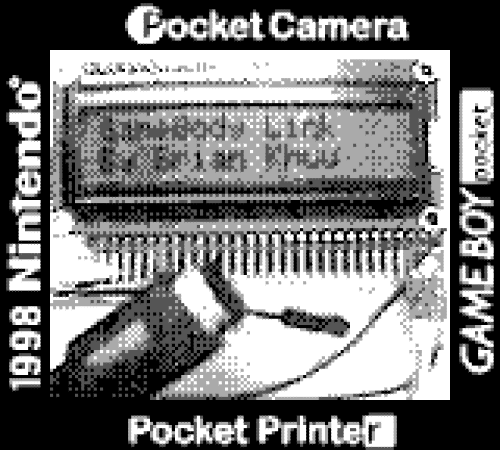
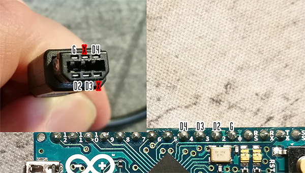
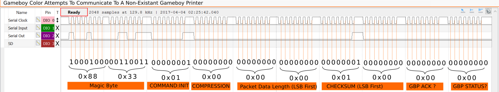
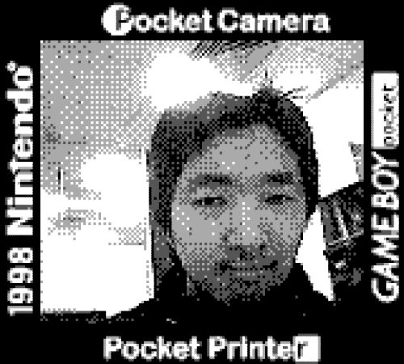

# Arduino Gameboy Printer Emulator (V3)


This project is a Game Boy Printer emulator for Arduino boards compatible and tested with the [110 games using the Game Boy Printer](https://docs.google.com/spreadsheets/d/1RQeTHemyEQnWHbKEhUy16cPxR6vA3YfeBbyx2tIXWaU). Goal is to provide an easy way for people to quickly set up and download images from their Game Boy. 100% game compatibility has been reached by reverse-engineering [Real Packet Capture Examples](https://github.com/mofosyne/GameboyPrinterSniffer/tree/master/RealCapture).

This emulator has been tested with Game Boy DMG (the brick), Game Boy Pocket, Game Boy Color, Game Boy Advance (regular and SP) and the Kong Feng GB Boy Colour. All work.

Despite using Arduino as the main target, the emulator code is also compatible with ESP8266, ESP32 and Raspberry Pi Pico derived boards with very minor adjustments (the relevant libraries — [**ESP8266 Arduino**](https://github.com/esp8266/Arduino), [**ESP32 by Espressif System**](https://github.com/espressif/arduino-esp32), or [**Arduino-Pico**](https://github.com/earlephilhower/arduino-pico) — must be installed in the Arduino IDE). No support is provided for these boards; use them at your own risk.

* Main project website: [https://mofosyne.github.io/arduino-gameboy-printer-emulator/](https://mofosyne.github.io/arduino-gameboy-printer-emulator/)

**Note: V3 now uses a raw packet decoder rather than the original tile decoder. This provides better support for Game Boy Printer-enabled games that use compression.**



## Official Releases

Downloads: [Version Release Downloads at GitHub](https://github.com/mofosyne/arduino-gameboy-printer-emulator/releases) / [Release Notes](./RELEASE_NOTES.md)

--------------------------------------------------------------------------------

## Telegram Gameboy Camera Chatroom

Got questions, need advice, or just want to share? Join the Telegram group:

**[https://t.me/gameboycamera](https://t.me/gameboycamera)**

--------------------------------------------------------------------------------

## Quick Installation Guide

### Step 1 — Flash the firmware

1. Install the [Arduino IDE](https://www.arduino.cc/en/software)
2. Download this project from GitHub (Code → Download ZIP) and unzip it to a local folder
3. Open `GameBoyPrinterEmulator/GameBoyPrinterEmulator.ino` in the Arduino IDE
4. Connect your Arduino, then select the correct board (Tools → Board) and port (Tools → Port)
5. Upload the sketch (Sketch → Upload)
6. Open the Serial Monitor and set the baud rate to **115200** — you should see a welcome message confirming the board is ready

Alternatively, if your browser supports WebUSB, you can flash the firmware directly without the Arduino IDE:

* [Arduino Nano WebSerial Firmware Flasher](./webbasedtools/arduino_nano/index.html)

### Step 2 — Wire your Game Boy and print

Connect the Game Boy link cable to your Arduino as described in the [wiring section](#building-the-arduino-gameboy-printer-emulator-from-scratch) below, then print from any compatible game. The Arduino will receive the raw packet data over serial.

### Step 3 — Get your images

Choose whichever method suits you:

| Method | Best for | Link |
|---|---|---|
| **Game Boy Printer Web** | Full-featured — palette control, photo library management, WebUSB | [Open tool](https://herrzatacke.github.io/gb-printer-web/#/) |
| **GBP Downloader** | Quick and lightweight — connect, print, save as PNG or ZIP, works offline | [Open tool](https://hexlions.github.io/GBP-Downloader/gbp_downloader.html) |
| **GBCamera Android Manager** | Field use with an Android phone | [GitHub](https://github.com/Mraulio/GBCamera-Android-Manager) |
| **GNU Octave / MATLAB** | Scripted or batch workflows | [GitHub](https://github.com/Raphael-Boichot/GameboyPrinterPaperSimulation) |
| **Python decoder** | Command-line / scripting | [Folder](/GameboyPrinterDecoderPython) |
| **JavaScript decoder** | Browser-based, offline | [Folder](/GameBoyPrinterDecoderJS) |
| **C decoder** | Advanced / compiled tool | [Folder](/GameBoyPrinterDecoderC) |

#### Capturing serial output as a log file (if not using Web Serial)

Arduino IDE v2 no longer makes it straightforward to copy serial output. Options:

- **Windows**: Use [PuTTY](https://datalab.medium.com/arduino-ide-serial-data-export-by-putty-6a77631a23ea) to log serial output to a file
- **Linux**: Use `screen` to capture output directly:

```bash
#!/bin/bash
# Press 'Ctrl+a' then 'k' to kill the session
# Run 'screen -r' to reattach if the window is closed
screen -L -Logfile "arduino_$(date +'%Y%m%d-%H%M%S').log" /dev/ttyUSB0 115200
```

The saved log file can then be pasted into the GBP Downloader's manual input field, or decoded with any of the tools listed above.

--------------------------------------------------------------------------------

## Building the Arduino Gameboy Printer Emulator from Scratch

Use an Arduino Nano or Uno and wire the Game Boy link cable according to the pinout below. Don't cut up old genuine Game Boy link cables — new cables are readily available online.

If you have a 3D printer, you can use a [Game Boy DMG-01 Link Port plug for Dupont jumper wires](https://www.thingiverse.com/thing:4685189) by Marko Štamcar from the Slovenian Computer Museum, created as part of a retro tech exhibition.

Thanks to West McGowan ([@imwestm](https://twitter.com/imwestm)) for submitting a clear wiring photo and tutorial. You can find it [here](https://westm.co.uk/arduino-game-boy-printer-emulator/).



```
Gameboy Original/Color Link Cable Pinout
 ___________
|  6  4  2  |
 \_5__3__1_/   (view at cable end)
```

| Arduino Pin | Gameboy Link Pin                 |
|-------------|----------------------------------|
| unused      | Pin 1 : 5.0V                     |
| D4          | Pin 2 : Serial OUTPUT (SOUT)     |
| D3          | Pin 3 : Serial INPUT  (SIN)      |
| unused      | Pin 4 : Serial Data              |
| D2          | Pin 5 : Serial Clock (Interrupt) |
| GND         | Pin 6 : GND                      |

Two important notes:

- **SIN and SOUT are crossed within the cable.** If the device doesn't work at first, try swapping them (physically, or in software by switching D3/D4). Wire colour is not a reliable indicator.
- **Third-generation link cables** (purple, or AGB-005) have a completely different pinout from GB/GBC cables. Avoid these unless you're confident about identifying the correct pins.

## Building with a Dedicated PCB

For a cleaner build, [dedicated PCBs](https://github.com/Raphael-Boichot/Collection-of-PCB-for-Game-Boy-Printer-Emulators) are available that are compatible with Arduino Nano/Uno and include a GBC socket — no cable cutting required.


The complete project shipped to your door should cost around €10 when ordering components and PCB from China.

--------------------------------------------------------------------------------

## Download Tools — Detailed Notes

### Game Boy Printer Web (Recommended — most feature-complete)

A full-featured photo manager for Game Boy Camera images with built-in support for this project. Connect via WebUSB or paste raw packet data directly.

[Enter Game Boy Printer Web](https://herrzatacke.github.io/gb-printer-web/#/)

To connect via WebUSB in the Arduino IDE Serial Monitor: Settings → Enable WebUSB, then go to WebUSB Serial devices → Open Web Serial devices.

### GBP Downloader

A single-page browser tool — no install required, works fully offline once loaded.

[Open GBP Downloader](https://hexlions.github.io/GBP-Downloader/gbp_downloader.html)

- Connect your Arduino via Web Serial (Chrome, Edge, or Opera on desktop)
- Photos appear in a gallery as your Game Boy prints them
- Export individual photos as PNG, or download everything as a ZIP
- Paste raw hex log files manually if you prefer to work from a captured log
- Works offline once the page has loaded

Requires Chrome, Edge, or Opera on desktop for Web Serial support.

### GBCamera Android Manager

An Android app for managing a Game Boy Camera gallery and communicating via USB serial with the Arduino Printer Emulator and GBxCart. When booting the Arduino with a Game Boy Printer connected and switched on, it will boot in printer mode — allowing you to output images from the Android app directly to the printer using the same wiring. In printer mode, the LED on pin 13 flashes to indicate the printer is ready.

[Enter GBCamera Android Manager](https://github.com/Mraulio/GBCamera-Android-Manager)

### Alternative WebUSB Firmware Flasher

Flash the firmware directly to an Arduino Nano from your browser without using the Arduino IDE:

* [Arduino Nano WebSerial Firmware Flasher](./webbasedtools/arduino_nano/index.html)
* [Arduino Nano WebSerial Serial Console](./webbasedtools/webserialConsole.html)

### JavaScript Decoder (Advanced)

For browser-based decoding of raw packet hex streams:

- [Raw packet decoder](./GameBoyPrinterDecoderJS/gameboy_printer_js_raw_decoder.html) — standard-compliant, supports compressed packets
- [Tile decoder](./GameBoyPrinterDecoderJS/gameboy_printer_js_decoder.html) — simpler tile-based approach

### C Decoder (Advanced)

A PC-based command-line tool for decoding raw packet captures into bitmap images. See the [Gameboy Printer Decoder C Readme](https://mofosyne.github.io/arduino-gameboy-printer-emulator/GameBoyPrinterDecoderC/) for build and usage instructions.

--------------------------------------------------------------------------------

## Media Coverage and Other Projects

More examples and community uses are collected in the **[showcase page](./showcase/showcase.md)**. A few highlights:

**[Featured On Hack A Day](https://hackaday.com/2017/12/01/arduino-saves-gameboy-camera/)**

**[WestM's Arduino Gameboy Printer Emulator Tutorial](https://westm.co.uk/arduino-game-boy-printer-emulator/)**

**[Rafael Zenaro: NeoGB Printer](https://github.com/zenaro147/Yet-Another-GBP-Emulator)**

**[Click for more examples in the Showcase Page](./showcase/showcase.md)**

--------------------------------------------------------------------------------

## Project Makeup

* **Arduino sketch** emulating a Game Boy Printer via serial link:
    - `./GameBoyPrinterEmulator/gpb_emulator.ino` — main source file
    - `./GameBoyPrinterEmulator/gameboy_printer_protocol.h` — reusable header with Game Boy protocol definitions
    - In **raw mode** (default since V3): outputs raw packets in hex, with the last two bytes of each packet being the printer's response. Example: `88 33 01 00 00 00 01 00 81 00`
    - In **tile mode**: outputs one Game Boy tile per line as hex. Example: `55 00 FB 00 5D 00 FF 00 55 00 FF 00 55 00 FF 00`

* **JavaScript decoders** — browser-based rendering of hex packet streams to downloadable images:
    - `./GameBoyPrinterDecoderJS/gameboy_printer_js_raw_decoder.html` — raw packet decoder (recommended)
    - `./GameBoyPrinterDecoderJS/gameboy_printer_js_decoder.html` — tile-based decoder

* **Research folder** — background documents and references used during development. The sniffer has moved to [https://github.com/mofosyne/GameboyPrinterSniffer](https://github.com/mofosyne/GameboyPrinterSniffer).

* **Sample images** — example output images and corresponding serial logs.

* **Showcase** — community examples and project spinoffs. See [showcase/showcase.md](./showcase/showcase.md).

--------------------------------------------------------------------------------

## Technical Information

### Sniffer / Real Gameboy Printer Captures

See [https://github.com/mofosyne/GameboyPrinterSniffer](https://github.com/mofosyne/GameboyPrinterSniffer) for details.

### Protocol

```
  | BYTE POS :    |     0     |     1     |     2     |      3      |     4     |     5     |  6 + X    | 6 + X + 1 | 6 + X + 2 | 6 + X + 3 | 6 + X + 4 |
  |---------------|-----------|-----------|-----------|-------------|-----------|-----------|-----------|-----------|-----------|-----------|-----------|
  | SIZE          |        2 Bytes        |  1 Byte   |   1 Byte    |  1 Bytes  |  1 Bytes  | Variable  |        2 Bytes        |  1 Bytes  |  1 Bytes  |
  | DESCRIPTION   |       SYNC_WORD       | COMMAND   | COMPRESSION |     DATA_LENGTH(X)    | Payload   |       CHECKSUM        |  DEVICEID |  STATUS   |
  | GB TO PRINTER |    0x88   |    0x33   | See Below | See Below   | Low Byte  | High Byte | See Below |       See Below       |    0x00   |    0x00   |
  | TO PRINTER    |    0x00   |    0x00   |    0x00   |   0x00      |    0x00   |    0x00   |    0x00   |    0x00   |    0x00   |    0x81   | See Below |
```

* Header comprises Command, Compression, and Data Length fields
* **Command** may be: Initialize (`0x01`), Data (`0x04`), Print (`0x02`), or Inquiry (`0x0F`)
* **Compression**: no compression (`0x00`), compressed (`0x01`)
* **Payload** length is determined by the `DATA_LENGTH` field
* **Checksum** is 2 bytes representing the sum of the header plus all data bytes
* **Status** is a bitfield byte indicating printer state (e.g. whether it is still printing)

### Gameboy Printer Timing

Measurements obtained via Digilent Analog Discovery:

```
                       1.153ms
        <--------------------------------------->
         0   1   2   3   4   5   6   7             0   1   2   3   4   5   6   7
     __   _   _   _   _   _   _   _   ___________   _   _   _   _   _   _   _   _
CLK:   |_| |_| |_| |_| |_| |_| |_| |_|           |_| |_| |_| |_| |_| |_| |_| |_|
DAT: ___XXXXXXXXXXXXXXXXXXXXXXXXXXXXXX____________XXXXXXXXXXXXXXXXXXXXXXXXXXXXXX_
       <-->                           <---------->
       127.63 us                         229.26 us
```

* Clock Frequency: 8kHz (127.63 µs)
* Transmission Speed: 867 baud (1.153ms per 8-bit symbol)
* Between Symbol Period: 229.26 µs



--------------------------------------------------------------------------------

## Research / Dev Log

### 2022-04-20

* V3.2.1 adds WebUSB firmware flasher for easier loading onto Arduino Nano
* Adjusted firmware messaging to reduce confusion around timeouts

### 2021-01-26

* V3 enables raw-only mode for better decompression on the PC side
* Updated and expanded showcase folder

### 2020-08-30

* V2 rewrite completed for broader game support
* Sniffer moved to [https://github.com/mofosyne/GameboyPrinterSniffer](https://github.com/mofosyne/GameboyPrinterSniffer)

### 2017-11-30

* The Arduino has been pushed to its limits — the main bottleneck is RAM
* CRC checking remains unimplemented, but the Game Boy Camera doesn't appear to verify it anyway
* Image processing is too RAM-intensive to do on the Arduino; raw data is transferred at 115200 baud and decoded on the PC side

### 2017-04-12

* Checksum works for Init and Inquiry packets but not reliably for Data packets
* The Game Boy Printer itself doesn't appear to enforce checksum validation
* Tile encoding confirmed as standard 16-byte Game Boy tile format via [huderlem's decoder](http://www.huderlem.com/demos/gameboy2bpp.html)
* Game Boy Camera buffers tile data in blocks of 2 × 20-tile-wide lines

## My Face In BW



----

# Credits / Other Resources

## Resources Referenced

* GameBoy PROGRAMMING MANUAL Version 1.0 DMG-06-4216-001-A Released 11/09/1999 — original Nintendo programming manual with a Game Boy Printer section. Copy included in the research folder.
* [http://www.huderlem.com/demos/gameboy2bpp.html](http://www.huderlem.com/demos/gameboy2bpp.html) — Game Boy tile decoder tutorial; part of the JS decoder is based on this
* [https://github.com/gism/GBcamera-ImageSaver](https://github.com/gism/GBcamera-ImageSaver) — an earlier attempt at the same problem; provided ideas for ISR-based bit capture and BMP output
* [https://gbdev.io/pandocs/Gameboy_Printer.html](https://gbdev.io/pandocs/Gameboy_Printer.html) — primary GB documentation on the printer protocol
* [http://furrtek.free.fr/?a=gbprinter&i=2](http://furrtek.free.fr/?a=gbprinter&i=2) — earlier work on printing to a Game Boy Printer
* [http://playground.arduino.cc/Main/Printf](http://playground.arduino.cc/Main/Printf) — printf support on Arduino
* [https://www.mikrocontroller.net/attachment/34801/gb-printer.txt](https://www.mikrocontroller.net/attachment/34801/gb-printer.txt) — the most detailed protocol writeup found online ([local backup](./ext_doc/gb-printer.txt))
* [https://gbdev.io/pandocs/Serial_Data_Transfer_(Link_Cable).html](https://gbdev.io/pandocs/Serial_Data_Transfer_(Link_Cable).html)
* [https://github.com/avivace/awesome-gbdev](https://github.com/avivace/awesome-gbdev) — collection of Game Boy development resources
* [https://shonumi.github.io/articles/art2.html](https://shonumi.github.io/articles/art2.html) — in-depth technical document covering the printer hardware, communication protocol, and typical game implementation

## Contributors / Thanks

* **@BjornB2** — improvements to image downloading in the JS decoder folder, including colour palette dropdown support ([#15](https://github.com/mofosyne/arduino-gameboy-printer-emulator/pull/15), [#18](https://github.com/mofosyne/arduino-gameboy-printer-emulator/pull/18))

* **@virtuaCode** — fixed rendering issues in the JS decoder ([#9](https://github.com/mofosyne/arduino-gameboy-printer-emulator/pull/9))

* **@HerrZatacke** — added per-image rendering in the JS decoder and Web USB support ([#19](https://github.com/mofosyne/arduino-gameboy-printer-emulator/pull/19))

* **@imwestm (West McGowan)** — wiring photo and tutorial, plus feedback that improved the instructions in this readme

* **Raphaël BOICHOT** — assistance capturing Game Boy communications and timing data; support for fast mode and compression; broader game compatibility work; [MATLAB/Octave decoder](https://github.com/Raphael-Boichot/GameboyPrinterPaperSimulation)

* **@crizzlycruz (@23kpixels)** — added zero-margin multi-print support to the JS decoder

* **@markostamcar** — contributed a 3D-printed link port plug so users can build a cable without sacrificing a genuine one

* **@tikonen** — contributed the Python decoder