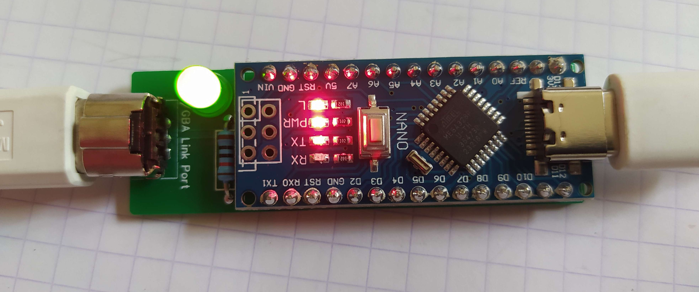

# Arduino Game Boy Printer Emulator (V3)


An Arduino-based emulator for the Game Boy Printer, tested against [110 Game Boy Printer–compatible games](https://docs.google.com/spreadsheets/d/1RQeTHemyEQnWHbKEhUy16cPxR6vA3YfeBbyx2tIXWaU). 100% game compatibility has been reached by reverse-engineering [real packet capture examples](https://github.com/mofosyne/GameboyPrinterSniffer/tree/master/RealCapture). Connect any compatible Game Boy to an Arduino, print as normal, and download your images to a PC or phone.

Tested hardware: Game Boy DMG (brick), Game Boy Pocket, Game Boy Color, Game Boy Advance (regular and SP), and the Kong Feng GB Boy Colour.

Despite using Arduino as the main target, the emulator code is also compatible with ESP8266, ESP32 and Raspberry Pi Pico derived boards with very minor adjustments (the relevant libraries — [**ESP8266 Arduino**](https://github.com/esp8266/Arduino), [**ESP32 by Espressif System**](https://github.com/espressif/arduino-esp32), or [**Arduino-Pico**](https://github.com/earlephilhower/arduino-pico) — must be installed in the Arduino IDE). No support is provided for these boards; use them at your own risk.

> **V3 note:** Raw packet mode is now the default. This gives better compatibility with games that use compression, with all decoding handled on the PC side rather than on the Arduino.

**Main project website:** [https://mofosyne.github.io/arduino-gameboy-printer-emulator/](https://mofosyne.github.io/arduino-gameboy-printer-emulator/)


**Downloads:** [GitHub Releases](https://github.com/mofosyne/arduino-gameboy-printer-emulator/releases) · [Release Notes](./RELEASE_NOTES.md)

---

## Telegram Game Boy Camera Chatroom

Questions, advice, or images to share? Join the community:

**[https://t.me/gameboycamera](https://t.me/gameboycamera)**

---

## Quick Start

There are three steps: flash the firmware, wire the Game Boy, then get your images.

---

### Step 1 — Flash the firmware

#### Option A: Web flasher (easiest — Arduino Nano only)

No software to install. Requires Chrome or Chromium (WebUSB support).

1. Open the [Arduino Nano WebSerial Firmware Flasher](./webbasedtools/arduino_nano/index.html) in Chrome or Chromium.
2. Connect your Arduino Nano via USB.
3. Click **"Flash Newer Arduino Nano (Test Blink Firmware)"** or **"Flash Older Arduino Nano (Test Blink Firmware)"** depending on your board's bootloader.
4. Confirm the onboard LED is blinking — this means the microcontroller is working.
5. Click **"Flash Newer Arduino Nano (GameBoy Printer Emulator)"** or **"Flash Older Arduino Nano (GameBoy Printer Emulator)"**.
6. Open the [Web Serial Monitor](./webbasedtools/webserialConsole.html), set the baud rate to **115200**, and confirm a welcome message appears.

#### Option B: Arduino IDE (any compatible board)

1. Install the [Arduino IDE](https://www.arduino.cc/en/software).
2. Download this project from GitHub (**Code → Download ZIP**) and unzip it.
3. Open `GameBoyPrinterEmulator/GameBoyPrinterEmulator.ino` in the Arduino IDE.
4. Connect your Arduino, then select the correct board (**Tools → Board**) and port (**Tools → Port**).
5. Upload the sketch (**Sketch → Upload**).
6. Open the [Web Serial Monitor](./webbasedtools/webserialConsole.html) (or any serial monitor), set the baud rate to **115200**, and confirm a welcome message appears.


---

### Step 2 — Wire the Game Boy link cable

Use an Arduino Nano or Uno. **Do not cut up original Game Boy link cables** — replacement cables are cheap and widely available online. If you have a 3D printer, this [Game Boy DMG-01 link port plug for Dupont wires](https://www.thingiverse.com/thing:4685189) (by Marko Štamcar) lets you make a clean connection without any cable at all.


*Photo and tutorial by West McGowan ([@imwestm](https://twitter.com/imwestm)) — [full tutorial here](https://westm.co.uk/arduino-game-boy-printer-emulator/).*

#### Link cable pinout

```
Gameboy Original/Color Link Cable Pinout
 ___________
|  6  4  2  |
 \_5__3__1_/   (view at cable end)
```

| Arduino pin | Game Boy link pin         |
|-------------|---------------------------|
| (unused)    | Pin 1 — 5.0V              |
| D4          | Pin 2 — Serial OUT (SOUT) |
| D3          | Pin 3 — Serial IN (SIN)   |
| (unused)    | Pin 4 — Serial Data       |
| D2          | Pin 5 — Clock (Interrupt) |
| GND         | Pin 6 — GND               |

> ⚠️ **SIN and SOUT are crossed inside the cable.** If nothing happens when you print, swap pins D3 and D4 — either physically, or by swapping them in the sketch. Wire colour is not a reliable guide to which is which.

> ⚠️ **Avoid third-generation (purple, AGB-005) link cables.** These have a completely different pinout from GB/GBC cables and will not work unless you can confidently identify the correct pins.

#### Using a dedicated PCB

For a cleaner build, [dedicated PCBs](https://github.com/Raphael-Boichot/Collection-of-PCB-for-Game-Boy-Printer-Emulators) are available that include a GBC socket and fit an Arduino Nano or Uno — no soldering to cables required. Complete builds ordered from China typically cost around €10.



Once wired, print from any compatible game. The Arduino will receive the data and output it over serial.

---

### Step 3 — Save your images

#### If you want to save the serial output first

Some workflows (especially if you're not using a Web Serial tool) require capturing the raw serial output to a log file first, then decoding it.

**Windows:** Use [PuTTY](https://datalab.medium.com/arduino-ide-serial-data-export-by-putty-6a77631a23ea) to log serial output to a file.

**Linux/macOS:** Use `screen`:

```bash
#!/bin/bash
# Press Ctrl+a then k to end the session
# Run 'screen -r' to reattach if you close the window
screen -L -Logfile "arduino_$(date +'%Y%m%d-%H%M%S').log" /dev/ttyUSB0 115200
```

> **Note:** Arduino IDE v2 no longer makes it easy to copy serial output to a file — PuTTY or `screen` are the recommended alternatives.

The saved log file can be pasted into GBP Downloader's manual input field or decoded with any of the tools below.

#### Decoding tools

| Tool                                                                                                                                                                                                                                          | Best for                                                                                                                                                                                                                                                                            |
|-----------------------------------------------------------------------------------------------------------------------------------------------------------------------------------------------------------------------------------------------|-------------------------------------------------------------------------------------------------------------------------------------------------------------------------------------------------------------------------------------------------------------------------------------|
| [**Game Boy Printer Web**](https://herrzatacke.github.io/gb-printer-web/#/) [(Source Code)](https://github.com/herrzatacke/gb-printer-web)                                                                                                    | Full-featured: palette control, photo library, WebUSB direct connection. To connect via WebUSB: **Settings → Enable WebUSB**, then **WebUSB Serial devices → Open Web Serial devices**                                                                                              |
| [**GBP Downloader**](https://hexlions.github.io/GBP-Downloader/gbp_downloader.html) [(Source Code)](https://github.com/HexLions/GBP-Downloader)                                                                                               | Fast and lightweight: connect, print, export PNG or ZIP — works offline                                                                                                                                                                                                             |
| [**GBCamera Android Manager**](https://github.com/Mraulio/GBCamera-Android-Manager)                                                                                                                                                           | Field use with an Android phone over USB serial. If you boot the Arduino with a real Game Boy Printer connected and switched on, it will boot in **printer mode** — allowing the app to output images directly to the physical printer. The LED on pin 13 flashes to indicate ready |
| [**JavaScript decoder**](./GameBoyPrinterDecoderJS/gameboy_printer_js_raw_decoder.html) [(Source Code)](https://github.com/mofosyne/arduino-gameboy-printer-emulator/blob/master/GameBoyPrinterDecoderJS/gameboy_printer_js_raw_decoder.html) | Browser-based, works offline                                                                                                                                                                                                                                                        |
| [**GNU Octave / MATLAB decoder**](https://github.com/Raphael-Boichot/GameboyPrinterPaperSimulation) [(Source Code)](https://github.com/mofosyne/arduino-gameboy-printer-emulator/tree/master/GameboyPrinterDecoderPython)                     | Scripted or batch processing workflows                                                                                                                                                                                                                                              |
| [**Python decoder**](./GameboyPrinterDecoderPython)                                                                                                                                                                                           | Command-line / scripting                                                                                                                                                                                                                                                            |
| [**C decoder**](./GameBoyPrinterDecoderC)                                                                                                                                                                                                     | Compiled command-line tool                                                                                                                                                                                                                                                          |

**Game Boy Printer Web** and **GBP Downloader** both support direct Web Serial connections (Chrome, Edge, or Opera on desktop) — you can print and watch images appear live without saving a log file at all.

---

## Technical Reference

### Project structure

| Component                                                     | Description                               |
|---------------------------------------------------------------|-------------------------------------------|
| `GameBoyPrinterEmulator/gpb_emulator.ino`                     | Main Arduino sketch                       |
| `GameBoyPrinterEmulator/gameboy_printer_protocol.h`           | Reusable header with protocol definitions |
| `GameBoyPrinterDecoderJS/gameboy_printer_js_raw_decoder.html` | Raw packet decoder (recommended)          |
| `GameBoyPrinterDecoderJS/gameboy_printer_js_decoder.html`     | Tile-based decoder                        |

**Raw mode** (default since V3): outputs raw packets as hex, with the printer's response as the final two bytes of each packet. Example:
```
88 33 01 00 00 00 01 00 81 00
```

**Tile mode**: outputs one Game Boy tile per line as hex. Example:
```
55 00 FB 00 5D 00 FF 00 55 00 FF 00 55 00 FF 00
```

### Protocol

```
  | BYTE POS :    |     0     |     1     |     2     |      3      |     4     |     5     |  6 + X    | 6 + X + 1 | 6 + X + 2 | 6 + X + 3 | 6 + X + 4 |
  |---------------|-----------|-----------|-----------|-------------|-----------|-----------|-----------|-----------|-----------|-----------|-----------|
  | SIZE          |        2 Bytes        |  1 Byte   |   1 Byte    |  1 Bytes  |  1 Bytes  | Variable  |        2 Bytes        |  1 Bytes  |  1 Bytes  |
  | DESCRIPTION   |       SYNC_WORD       | COMMAND   | COMPRESSION |     DATA_LENGTH(X)    | Payload   |       CHECKSUM        |  DEVICEID |  STATUS   |
  | GB TO PRINTER |    0x88   |    0x33   | See Below | See Below   | Low Byte  | High Byte | See Below |       See Below       |    0x00   |    0x00   |
  | TO PRINTER    |    0x00   |    0x00   |    0x00   |   0x00      |    0x00   |    0x00   |    0x00   |    0x00   |    0x00   |    0x81   | See Below |
```

- **SYNC_WORD**: always `0x88 0x33`
- **Command**: `0x01` Initialize · `0x04` Data · `0x02` Print · `0x0F` Inquiry
- **Compression**: `0x00` none · `0x01` compressed
- **Payload**: variable length, specified by DATA_LENGTH
- **Checksum**: 2-byte sum of header + all data bytes
- **Status**: bitfield byte indicating printer state (e.g. still printing)

### Timing

Measured with a Digilent Analog Discovery:

```
                       1.153ms
        <--------------------------------------->
         0   1   2   3   4   5   6   7             0   1   2   3   4   5   6   7
     __   _   _   _   _   _   _   _   ___________   _   _   _   _   _   _   _   _
CLK:   |_| |_| |_| |_| |_| |_| |_| |_|           |_| |_| |_| |_| |_| |_| |_| |_|
DAT: ___XXXXXXXXXXXXXXXXXXXXXXXXXXXXXX____________XXXXXXXXXXXXXXXXXXXXXXXXXXXXXX_
       <-->                           <---------->
       127.63 us                         229.26 us
```

| Parameter           | Value               |
|---------------------|---------------------|
| Clock frequency     | 8 kHz               |
| Bit period          | 127.63 µs           |
| 8-bit Symbol period | 1.153 ms (867 baud) |
| Inter-symbol gap    | 229.26 µs           |


### Sniffer / real Game Boy printer captures

See [https://github.com/mofosyne/GameboyPrinterSniffer](https://github.com/mofosyne/GameboyPrinterSniffer) for real packet capture examples used during development.

---

## Dev Log

**2022-04-20** — V3.2.1: WebUSB firmware flasher added for easier loading onto Arduino Nano; firmware messaging improved to reduce confusion around timeouts.

**2021-01-26** — V3: raw-only mode enabled for better decompression on the PC side; showcase folder expanded.

**2020-08-30** — V2 rewrite for broader game support; sniffer moved to separate repo.

**2017-11-30** — Arduino RAM is the main bottleneck; CRC checking unimplemented (Game Boy Camera doesn't verify it anyway); image processing offloaded to PC at 115200 baud.

**2017-04-12** — Checksum working for Init and Inquiry packets; tile encoding confirmed as standard 16-byte Game Boy tile format via [huderlem's decoder](http://www.huderlem.com/demos/gameboy2bpp.html); Game Boy Camera buffers tiles in 2 × 20-tile-wide line blocks.

---

## Sample Output


---

## Media and Community Projects

More examples are in the **[showcase page](./showcase/showcase.md)**. Highlights:

- **[Hack A Day feature](https://hackaday.com/2017/12/01/arduino-saves-gameboy-camera/)**
- **[WestM's wiring tutorial](https://westm.co.uk/arduino-game-boy-printer-emulator/)**
- **[Rafael Zenaro: NeoGB Printer](https://github.com/zenaro147/Yet-Another-GBP-Emulator)**

---

## Credits

### References

- GameBoy Programming Manual v1.0 (DMG-06-4216-001-A, 1999) — includes the original Game Boy Printer section; copy in the research folder
- [huderlem's Game Boy tile decoder](http://www.huderlem.com/demos/gameboy2bpp.html) — basis for part of the JS decoder
- [GBcamera-ImageSaver](https://github.com/gism/GBcamera-ImageSaver) — earlier project; source of ideas for ISR-based bit capture and BMP output
- [Pan Docs — Game Boy Printer](https://gbdev.io/pandocs/Gameboy_Printer.html) — primary protocol documentation
- [furrtek's earlier printer work](http://furrtek.free.fr/?a=gbprinter&i=2)
- [printf on Arduino](http://playground.arduino.cc/Main/Printf)
- [gb-printer.txt](https://www.mikrocontroller.net/attachment/34801/gb-printer.txt) — the most detailed protocol writeup found ([local backup](./ext_doc/gb-printer.txt))
- [GB serial transfer docs](https://gbdev.io/pandocs/Serial_Data_Transfer_(Link_Cable).html)
- [awesome-gbdev](https://github.com/avivace/awesome-gbdev)
- [Shonumi's in-depth printer article](https://shonumi.github.io/articles/art2.html)

### Contributors

| Contributor                   | Contribution                                                                                                                                                                                                                               |
|-------------------------------|--------------------------------------------------------------------------------------------------------------------------------------------------------------------------------------------------------------------------------------------|
| **@BjornB2**                  | Improved image downloading in the JS decoder, including colour palette dropdown ([#15](https://github.com/mofosyne/arduino-gameboy-printer-emulator/pull/15), [#18](https://github.com/mofosyne/arduino-gameboy-printer-emulator/pull/18)) |
| **@virtuaCode**               | Fixed rendering issues in the JS decoder ([#9](https://github.com/mofosyne/arduino-gameboy-printer-emulator/pull/9))                                                                                                                       |
| **@HerrZatacke**              | Per-image rendering and WebUSB support in the JS decoder ([#19](https://github.com/mofosyne/arduino-gameboy-printer-emulator/pull/19))                                                                                                     |
| **@imwestm (West McGowan)**   | Wiring photo and tutorial; improved the wiring instructions                                                                                                                                                                                |
| **Raphaël Boichot**           | Game Boy comms and timing captures; fast mode and compression support; broader game compatibility; [MATLAB/Octave decoder](https://github.com/Raphael-Boichot/GameboyPrinterPaperSimulation)                                               |
| **@crizzlycruz (@23kpixels)** | Zero-margin multi-print support in the JS decoder                                                                                                                                                                                          |
| **@markostamcar**             | 3D-printed link port plug                                                                                                                                                                                                                  |
| **@tikonen**                  | Python decoder                                                                                                                                                                                                                             |